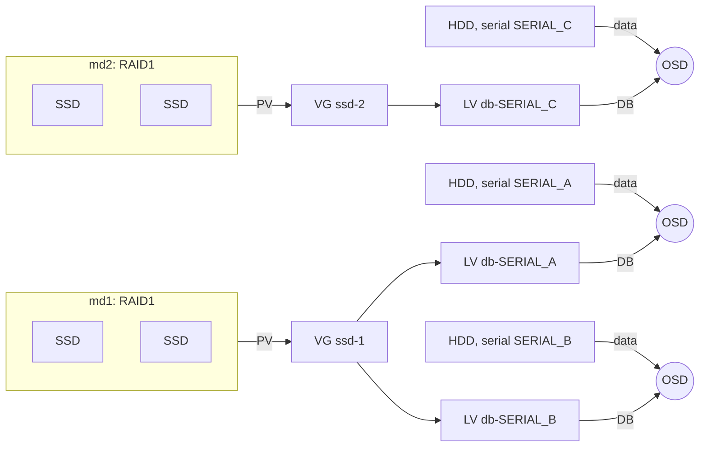
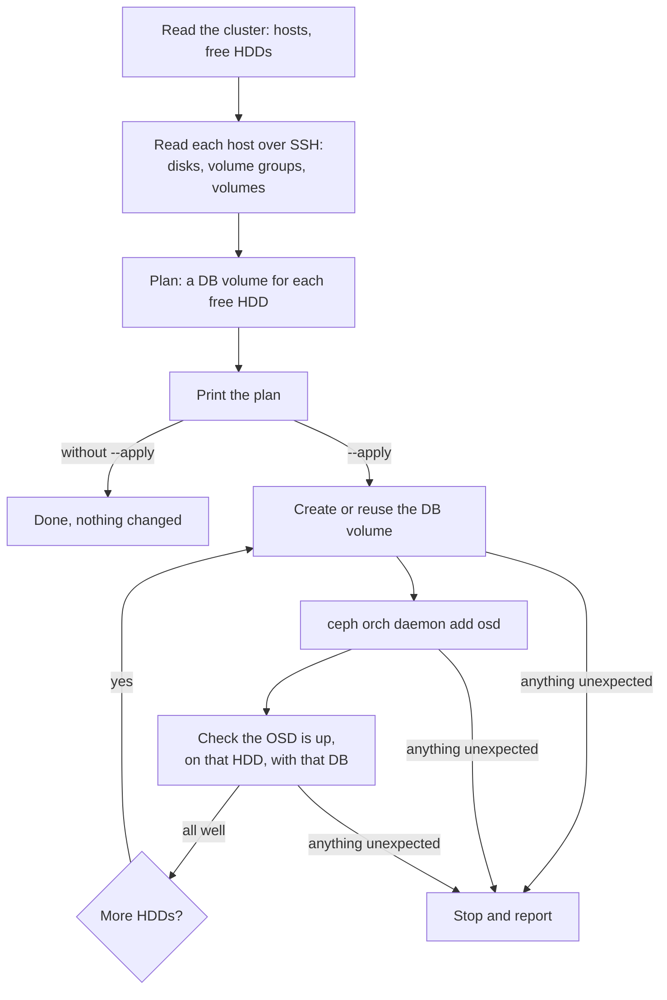

# `cephkit osd add`: OSDs with their DB on RAID-backed LVM

## The problem

An HDD OSD is much faster with its BlueStore DB on flash. A lone SSD holding the DBs of several OSDs is a
single point of failure for all of them, so the SSDs are mirrored with md RAID, LVM sits on top, and each HDD
gets its own DB logical volume.

cephadm cannot build this layout on its own. It
never creates md arrays, names the DB volumes it carves its own way, and can't add one more DB to an array
that already holds some. So the DB volumes are made by hand and passed to cephadm by path, one OSD at a time,
with a check after every step. `cephkit osd add` does that work and those checks.

## The layout



You create the md arrays and a volume group on each, named `ssd-1`, `ssd-2` and so on. The command does the
rest: each HDD gets a DB volume named `db-<serial>`, after the HDD it serves. The serial, not `sdX`, ties the
HDD, its DB and its OSD together, because `sdX` names can change at every boot.

## How it works



The command reads the cluster with `ceph` on the admin node, and each storage node over SSH. It plans first
and prints the plan. With `--apply` it creates the OSDs one at a time and checks each one on the host and in
the cluster before starting the next.

## Reaching the hosts

cephkit logs in to a storage node the way cephadm does: as cephadm's user, at the address from
`ceph orch host ls`, with cephadm's key. It reads the key from the cluster into an ssh-agent of its own for
the run, never writes it to disk, and stops the agent when it ends. Your SSH config takes no part in these
logins, so they are exactly cephadm's. Each host's SSH key is recorded in your `~/.ssh/known_hosts` on first
contact, and a changed one is refused.

To log in with your own SSH keys and config instead, for example through a jump host, add `--ssh-own-key` or
set `CEPHKIT_SSH=own`.

## Using it

```
cephkit osd add host1 /dev/sdd                  # one OSD on /dev/sdd, or give its serial
cephkit osd add host1 --any                     # one OSD on the first free HDD
cephkit osd add host1 --all-available-devices   # every free HDD on host1
cephkit osd add --all-hosts                     # every free HDD on every host
```

Add `--apply` to any of them to carry the plan out. A run looks like this:

```
$ cephkit osd add host1 --all-available-devices --apply
cephkit osd add, 2026-11-12 10:43:49

host1: 2 OSD(s) planned, DB size 128 GiB (the size of the 2 DBs in use on host1)
  /dev/sdd   SN0003          14.6 TiB  -> ssd-1/db-SN0003  create: fewest DBs (1 in use)
  /dev/sde   SN0004          14.6 TiB  -> ssd-2/db-SN0004  reuse: exists and no OSD uses it
  each DB is 0.86% of its HDD and holds RocksDB levels L1-L3 whole (73 GiB)

10:43:49 host1 /dev/sdd SN0003: created ssd-1/db-SN0003
10:43:49 host1 /dev/sdd SN0003: ceph orch daemon add osd (cephadm allows 15m)
10:44:19 host1 /dev/sdd SN0003: still running (30s)
10:44:24 host1 /dev/sdd SN0003: osd.12 prepared (35s), waiting for it to boot (up to 5m)
10:44:54 host1 /dev/sdd SN0003: still waiting (30s)
10:45:24 host1 /dev/sdd SN0003: still waiting (1m00s)
10:45:54 host1 /dev/sdd SN0003: still waiting (1m30s)
10:46:24 host1 /dev/sdd SN0003: still waiting (2m00s)
10:46:38 host1 /dev/sdd SN0003: osd.12 up with its DB on md1 (2m49s)
10:46:38 host1 /dev/sde SN0004: reusing ssd-2/db-SN0004
10:46:38 host1 /dev/sde SN0004: ceph orch daemon add osd (cephadm allows 15m)
10:47:05 host1 /dev/sde SN0004: stopped: ceph-volume did not take ssd-2/db-SN0004: it has no ceph.osd_id tag. cephadm may report this only in its log: see `ceph log last cephadm`
10:47:05 host1 /dev/sde SN0004: ssd-2/db-SN0004 exists, untagged

10:47:05 1 OSD(s) created before the stop
```

## Rules, and why

- **A DB goes to the volume group holding the fewest DBs, counting those in use and those planned earlier in
  the same run.** Fewer OSDs on one array means fewer lost with it, and the SSDs wear evenly. `--vg` puts every
  DB of a run in one group.
- **A DB is as big as the DBs already in use on the host.** A host's OSDs stay alike. A host with no DBs yet,
  or with DBs of different sizes, needs `--db-size`, because the right size depends on the workload.
- **An unused `db-<serial>` volume is reused, one taken by an OSD never is.** A volume left from an earlier
  attempt is picked up again; one that belongs to an OSD is not touched.
- **The tool remembers nothing between runs.** Every run starts from what the cluster and the hosts say now,
  so running the same command again picks up where a stopped run left off.
- **Success is read from the cluster, not from cephadm.** cephadm's exit status and messages can say a
  failed OSD was created, or a created one failed.
- **An old disk label where a new DB volume lands stops the run.** You decide whether to wipe it.

## When it stops

The last lines say what went wrong and how the DB volume looks now: missing, untagged, or tagged for an OSD.
What a failure leaves behind depends on where it happened and on the Ceph release, so the tool reports it and
changes nothing more. Look at `ceph log last cephadm` and `ceph orch ps <host>`, set things right, and run the
same command again.

## Where to look

- `cephkit/osd.py`: the plan and the checks, each with a comment on why it is there.
- `tests/test_osd_plan.py`, `tests/test_osd_apply.py`: one test for each way a plan or a run can go wrong.
- `tests/test_osd_add_wiring.py`: the whole command against stand-ins for `ceph` and `ssh`.
